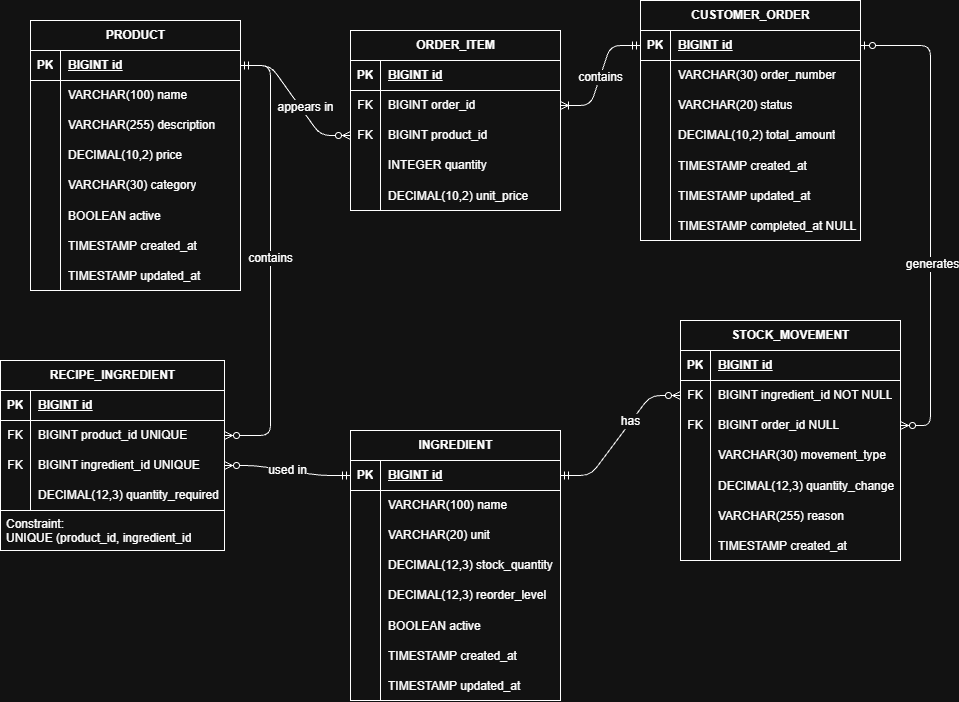
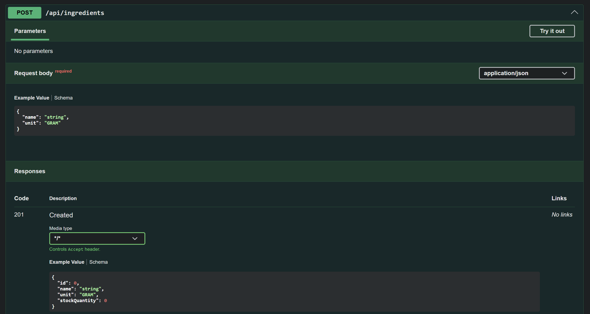

# Coffee Shop POS and Inventory Management System

A Java 21 and Spring Boot backend project for a coffee shop point-of-sale (POS) and inventory management system.

## Table of Contents

- [About](#about)
- [Tech Stack](#tech-stack)
- [Architecture](#architecture)
  - [Design](#design)
- [Current Features](#current-features)
  - [Ingredient Management](#ingredient-management)
  - [Validation & Error Handling](#validation--error-handling)
  - [Database Persistence](#database-persistence)
- [API Documentation](#api-documentation)
  - [Current Endpoints](#current-endpoints)
  - [Example: Create an Ingredient](#example-create-an-ingredient)
  - [Example: Replenish Stock](#example-replenish-stock)
  - [Example: Consume Stock](#example-consume-stock)
- [Getting Started](#getting-started)
- [Testing](#testing)
- [Development Progress](#development-progress)

## About

I've previously covered some Spring Boot through online courses, but wanted to revisit the fundamentals and put what I've learned into practice through a project of my own, building on my existing Java and OOP experience.

I'm developing the application iteratively, starting with simple implementations to revisit core Spring Boot concepts before gradually introducing more complex functionality.

The initial focus is ingredient and inventory management, with plans to expand into product catalogues, recipes and order processing.

Along the way, I'm looking to strengthen my understanding of REST API development, application design, database persistence, business logic, testing and backend engineering practices.

## Tech Stack

**Backend**
- Java 21
- Spring Boot 4
- Spring Web MVC
- Spring Data JPA / Hibernate
- Jakarta Bean Validation
- Maven

**Database & Infrastructure**
- PostgreSQL 17
- Flyway (database migrations)
- Docker / Docker Compose

**Testing & Documentation**
- JUnit 5
- Mockito
- Spring MockMvc
- Springdoc OpenAPI / Swagger UI

## Architecture

The application follows a layered architecture, separating HTTP request handling, business logic and database access.

- **Controller:** Exposes REST endpoints and handles incoming requests and responses.
- **Service:** Coordinates ingredient operations and enforces application workflows.
- **Repository:** Provides database access through Spring Data JPA.
- **Entity:** Represents ingredients and encapsulates stock management rules.
- **DTOs:** Define request and response structures independently of persistence entities.

Ingredients are persisted in PostgreSQL, with Hibernate handling object-relational mapping and Flyway managing database schema changes.

### Design

The initial ERD outlines the proposed data model for the application and will evolve as development progresses.



*The ERD represents the planned data model. Currently, only the initial ingredients table has been implemented.*

## Current Features

### Ingredient Management

- Create ingredients with a name and measurement unit.
- Retrieve all ingredients or an individual ingredient by ID.
- Persist ingredient records in PostgreSQL.
- Replenish ingredient stock.
- Consume ingredient stock.
- Track quantities using `BigDecimal` for decimal precision.
- Support measurement units including grams, millilitres and individual units.

### Validation & Error Handling

- Reject blank ingredient names and missing measurement units.
- Reject zero or negative stock adjustments.
- Prevent stock consumption when insufficient quantity is available.
- Return appropriate HTTP responses, including:
    - `400 Bad Request` for invalid input.
    - `404 Not Found` for missing ingredients.
    - `409 Conflict` for insufficient stock.
- Handle application exceptions through centralised exception handling.

### Database Persistence

- PostgreSQL database running in Docker.
- Spring Data JPA repositories for persistence operations.
- Hibernate entity mapping and schema validation.
- Version-controlled SQL migrations using Flyway.
- Persistent Docker volume for local database storage.

## API Documentation

Interactive API documentation and testing are available through Swagger UI, using Springdoc OpenAPI.

To explore the API, run the Spring Boot application locally and navigate to:

http://localhost:8080/swagger-ui.html



### Current Endpoints

| Method | Endpoint | Description |
|---|---|---|
| GET | `/api/ingredients` | Retrieve all ingredients |
| GET | `/api/ingredients/{id}` | Retrieve an ingredient by ID |
| POST | `/api/ingredients` | Create a new ingredient |
| POST | `/api/ingredients/{id}/replenish` | Replenish ingredient stock |
| POST | `/api/ingredients/{id}/consume` | Consume ingredient stock |

_Additional endpoints will be introduced as development progresses._

### Example: Create an Ingredient

**POST** `/api/ingredients`

Request:

```json
{
  "name": "Coffee Beans",
  "unit": "GRAM"
}
```

Example response (`201 Created`):

```json
{
  "id": 1,
  "name": "Coffee Beans",
  "unit": "GRAM",
  "stockQuantity": 0
}
```

### Example: Replenish Stock

**POST** `/api/ingredients/1/replenish`

Request:

```json
{
  "quantity": 500
}
```

Example response (`200 OK`):

```json
{
  "id": 1,
  "name": "Coffee Beans",
  "unit": "GRAM",
  "stockQuantity": 500
}
```

### Example: Consume Stock

**POST** `/api/ingredients/1/consume`

Request:

```json
{
  "quantity": 200
}
```

Example response (`200 OK`):

```json
{
  "id": 1,
  "name": "Coffee Beans",
  "unit": "GRAM",
  "stockQuantity": 300
}
```

If a consumption request exceeds the available stock, the API rejects the operation with `409 Conflict`.

*Additional endpoints will be introduced as development progresses.*

## Getting Started

### Prerequisites

- Java 21
- Docker Desktop
- Git
- An IDE such as IntelliJ IDEA

The Maven Wrapper is included in the repository, so a separate Maven installation is not required.

### 1. Clone the Repository

```bash
git clone https://github.com/estibenjack/coffee-pos-system.git
cd coffee-pos-system
```

### 2. Configure the Database Password

Create a `.env` file in the project root, alongside `compose.yaml`:

```env
DB_PASSWORD=your_local_password
```

The `.env` file is excluded from version control.

The same password must be provided to Spring Boot through the `DB_PASSWORD` environment variable.

### 3. Start PostgreSQL

Ensure Docker Desktop is running, then execute:

```bash
docker compose up -d
```

This starts a PostgreSQL 17 container and creates a persistent Docker volume for database storage.

### 4. Run the Application

In PowerShell, set the environment variable:

```powershell
$env:DB_PASSWORD = "your_local_password"
```

Then start the application:

```powershell
.\mvnw.cmd spring-boot:run
```

Alternatively, configure `DB_PASSWORD` in your IntelliJ run configuration.

On startup, Flyway applies any outstanding database migrations, and Hibernate validates the database schema.

### 5. Explore the API

Open Swagger UI:

http://localhost:8080/swagger-ui.html

### 6. Run the Tests

```powershell
.\mvnw.cmd test
```

**Note:** The application context test currently requires a running PostgreSQL instance and the `DB_PASSWORD` environment variable. Dedicated database integration testing with Testcontainers is planned.

## Testing

The project currently includes **22 passing automated tests**, covering:

| Test Class | Tests | Focus |
|---|---:|---|
| `IngredientTest` | 3 | Domain logic and stock calculations |
| `IngredientServiceTest` | 4 | Service operations and mocked repository interactions |
| `IngredientControllerTest` | 14 | REST endpoints, validation and HTTP responses |
| `CoffeePosSystemApplicationTests` | 1 | Spring Boot application context startup |
| **Total** | **22** | |

JUnit 5 is used for testing, Mockito for isolating dependencies and MockMvc for testing HTTP behaviour without starting a full HTTP server.

Future testing improvements include PostgreSQL integration tests using Testcontainers, allowing database operations to be tested against isolated, disposable database instances.

## Development Progress

The project initially used temporary in-memory storage to explore Spring Boot fundamentals, REST controllers, dependency injection and business logic.

The ingredient management module now uses PostgreSQL persistence through Spring Data JPA, with Flyway managing database migrations and Docker Compose providing the local development environment.

Development is ongoing, with the next focus on database integration testing using Testcontainers, followed by expanding the application to support products, recipes and order processing.